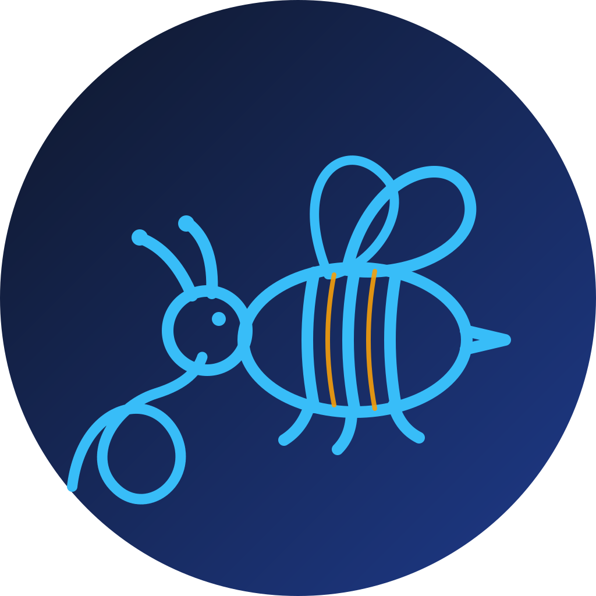

<div align="center">

<a href="https://github.com/opensourcera"></a>


<a href="https://git.io/typing-svg"></a>

<br/>

<a href="https://ideauseful.com"></a>
<a href="https://www.unibijoy.com"></a>
<a href="mailto:info@unibijoy.com"></a>


</div>

<br/>

## 🧘 The Zen of opensourcera

```text
Freedom first.              Software you can read, change and share.
Simple beats clever.        One clear idea is worth a thousand features.
Instant release.            Ship the idea today, polish it in the open.
Small is powerful.          Tiny code on a microcontroller is still real software.
Tools should disappear.     The best tool gets out of your way.
If it is useful, open it.   Someone, somewhere, needs exactly this.
```

<br/>

## 🛠️ What I build

<div align="center">

| 🔌 Tiny code | ⌨️ Keyboard tools | 💰 Financial tools |
|:---:|:---:|:---:|
| Microcontroller firmware and bare-metal utilities that do one job well | System-wide input tools for Windows, like **Raisin** | Simple, transparent tools for money, markets and bookkeeping |
| *C · C++ · Arduino* | *C# · .NET · Win32 API* | *C# · Python · JavaScript* |

</div>

- 🔭 **Right now:** [Raisin](https://github.com/opensourcera/raisin), a zero-config keyboard tool for Windows built on .NET 8
- 🚀 **How I work:** simple idea, instant release, then iterate in public
- 🤝 **Open to:** collaboration on any small, useful, freely licensed tool
- 💬 **Ask me about:** keyboard hooks, low-latency input pipelines, shipping tiny tools fast

<br/>

## ⭐ Featured project

<div align="center">

<a href="https://github.com/opensourcera/raisin">
  
</a>

<br/><br/>

| ⚡ Hook latency | 📚 Dictionary | 🧩 Plugins | 🖥️ Platform |
|:---:|:---:|:---:|:---:|
| **< 0.2 ms** | **60k+ words** | **SDK built in** | **.NET 8 · Windows 10/11** |

<br/>

**Raisin** is a system-wide keyboard tool: it intercepts keystrokes and rewrites them for *any* app,
with no IME and no per-app configuration. A simple idea, released instantly, improved in the open.

<a href="https://www.unibijoy.com"></a>
<a href="https://github.com/opensourcera/raisin"></a>
<a href="https://github.com/opensourcera/raisin/issues"></a>
<a href="https://github.com/opensourcera/raisin/blob/main/LICENSE"></a>

</div>

<br/>

## 🧰 Tech stack

<div align="center">


<br/><br/>


</div>

<br/>

## 📊 GitHub stats

<div align="center">


<br/><br/>


<br/><br/>

<picture>
  <source media="(prefers-color-scheme: dark)" srcset="https://raw.githubusercontent.com/opensourcera/opensourcera/output/github-snake-dark.svg"/>
  <source media="(prefers-color-scheme: light)" srcset="https://raw.githubusercontent.com/opensourcera/opensourcera/output/github-snake.svg"/>
  
</picture>

</div>

<br/>

## 🤝 Let's connect

<div align="center">

<a href="https://ideauseful.com"></a>
<a href="https://www.unibijoy.com"></a>
<a href="https://github.com/opensourcera/raisin/discussions"></a>
<a href="mailto:info@unibijoy.com"></a>

<br/><br/>

> **Believe in freedom. Simple idea, instant release.** Fork anything here, open an issue, or just say hi 🚀


</div>
